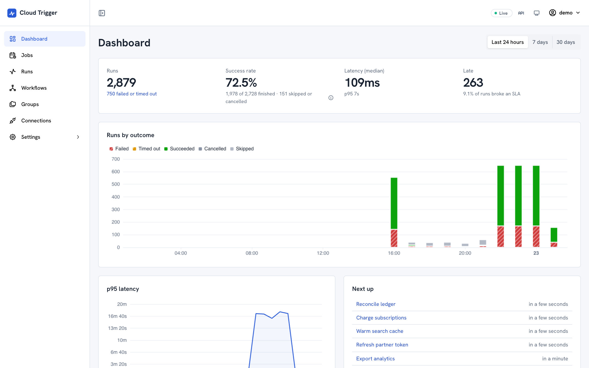
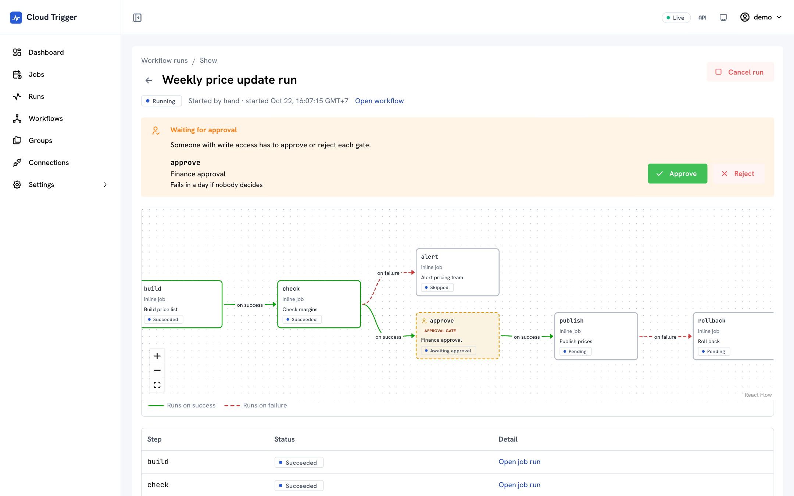
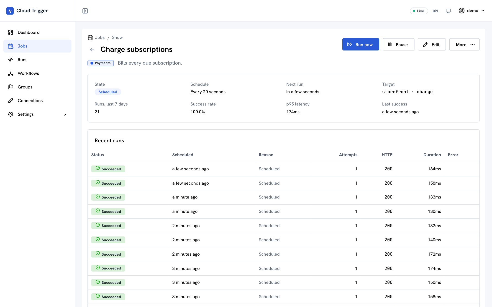
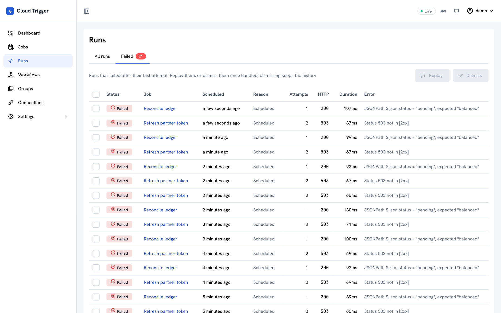
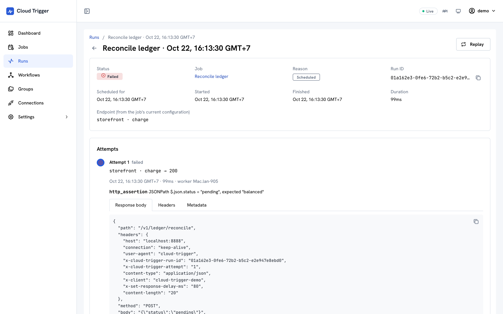
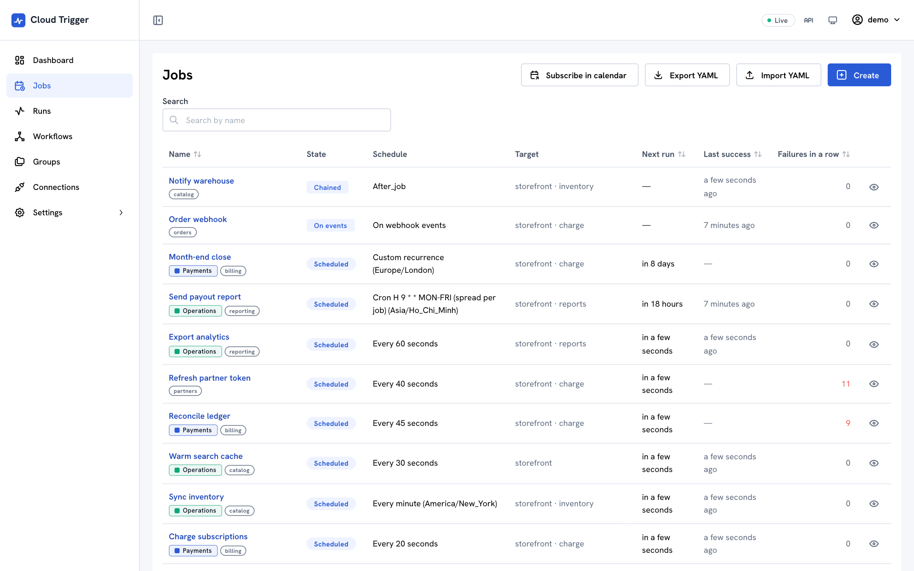
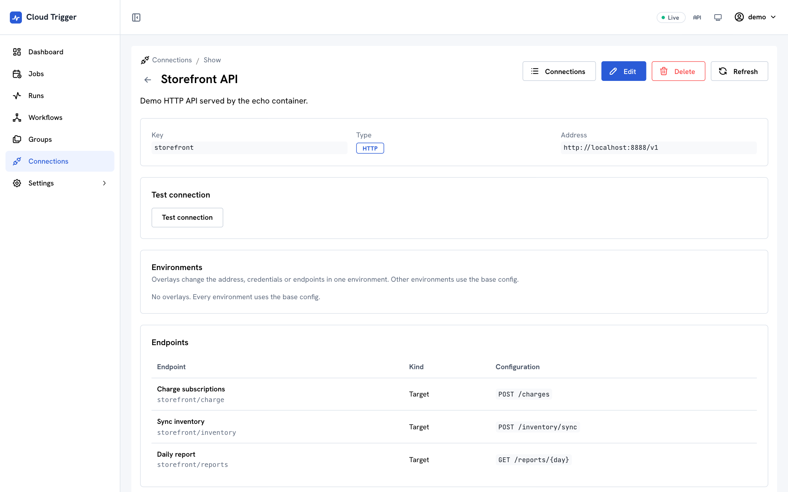
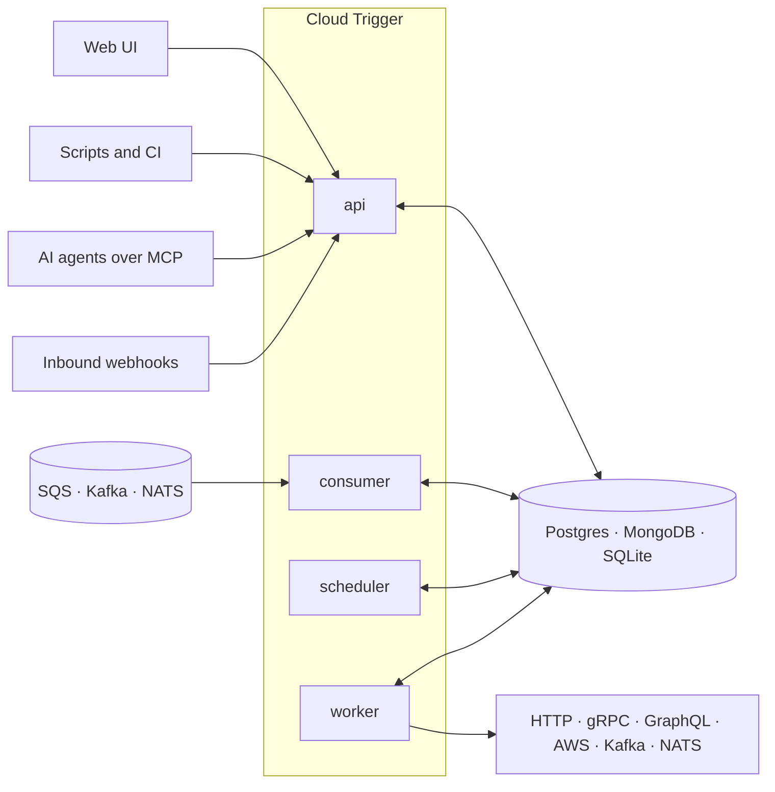

<div align="center">

<picture>
  <source media="(prefers-color-scheme: dark)" srcset="docs/assets/logo-wordmark-dark.svg">
  
</picture>

### Schedule anything. Trigger everything. Self-hosted.

Cron, events and workflows for every endpoint (HTTP, gRPC, GraphQL, Kafka, NATS and AWS), with no SDK in your code.

[](https://github.com/dragonxsx/cloud-trigger/actions/workflows/ci.yml)
[](LICENSE)


[Website](https://dragonxsx.github.io/cloud-trigger/) · [Quick start](#quick-start) · [Features](#features) · [Providers](docs/providers.md) · [Docs](docs/README.md)

<br>

<picture>
  <source media="(prefers-color-scheme: dark)" srcset="docs/assets/screenshots/dashboard-dark.png">
  
</picture>

</div>

## Why Cloud Trigger

Most scheduled work is a request to a service you already run: charge the due subscriptions, sync the catalogue, rebuild a report. Cloud Trigger makes those calls on time, retries them, chains them and shows you what happened.

- **Calls what you already have.** Jobs target existing HTTP, gRPC, GraphQL, SQS, SNS, EventBridge, Kafka and NATS endpoints. Nothing to embed or redeploy.
- **Time and events in one place.** Cron, intervals, calendar rules, inbound webhooks and queue consumers all start the same kind of job, with the same retries, history and alerts.
- **Workflows with a human in the loop.** Chain jobs into DAGs that branch on success or failure and pause at approval gates.
- **Safe to scale.** Short leases and per-fire-time idempotency keys give exactly-once firing across any number of scheduler and worker replicas.
- **Your infrastructure, your database.** Run one container on SQLite, or split roles on Kubernetes with Postgres or MongoDB.

**Not the right tool if** you want durable step functions written inside your application code (an SDK workflow engine fits that better), a hosted service, or sub-second scheduling precision.

## Features

| Area            | What you get                                                                                                                                 |
| --------------- | -------------------------------------------------------------------------------------------------------------------------------------------- |
| **Schedules**   | Cron with time zones, `L`, `#` and `H` spreading; intervals; one-off runs; RFC 5545 `RRULE` with excluded dates; bounds, max runs and jitter |
| **Events**      | Signed, idempotent, rate-limited webhooks; SQS, Kafka and NATS JetStream consumers; `after_job` chaining                                     |
| **Targets**     | HTTP with response assertions and signing, GraphQL, gRPC, SQS, SNS, EventBridge, Kafka, NATS, and fan-out                                    |
| **Connections** | Shared addresses, credentials and named endpoints; OpenAPI import; per-environment overrides                                                 |
| **Workflows**   | DAGs with success, failure and any-outcome edges, inline steps, approval gates and a live graph                                              |
| **Reliability** | Overlap and missed-run policies, retries with backoff, auto-pause, SLAs, group rate limits, backfill                                         |
| **Operations**  | Dashboard, failed-runs inbox with bulk replay, "Why didn't it run?", OpenTelemetry, Prometheus, SSE, badges, iCal                            |
| **Access**      | Passwords, OIDC and scoped API keys; secrets encrypted at rest and redacted everywhere                                                       |
| **AI agents**   | An MCP server at `/mcp` with the same keys and scopes as the API                                                                             |

The full list is in the [feature reference](#feature-reference).

## Screenshots

<table>
  <tr>
    <td width="50%">
      <picture>
        <source media="(prefers-color-scheme: dark)" srcset="docs/assets/screenshots/workflow-run-dark.png">
        
      </picture>
      <p align="center"><b>Workflow run</b> waiting at an approval gate</p>
    </td>
    <td width="50%">
      <picture>
        <source media="(prefers-color-scheme: dark)" srcset="docs/assets/screenshots/job-dark.png">
        
      </picture>
      <p align="center"><b>Job</b> with schedule, health and recent runs</p>
    </td>
  </tr>
  <tr>
    <td width="50%">
      <picture>
        <source media="(prefers-color-scheme: dark)" srcset="docs/assets/screenshots/failed-runs-dark.png">
        
      </picture>
      <p align="center"><b>Failed runs</b> inbox with bulk replay</p>
    </td>
    <td width="50%">
      <picture>
        <source media="(prefers-color-scheme: dark)" srcset="docs/assets/screenshots/run-dark.png">
        
      </picture>
      <p align="center"><b>Run</b> with every attempt and its response</p>
    </td>
  </tr>
  <tr>
    <td width="50%">
      <picture>
        <source media="(prefers-color-scheme: dark)" srcset="docs/assets/screenshots/jobs-dark.png">
        
      </picture>
      <p align="center"><b>Jobs</b> with schedules and next runs</p>
    </td>
    <td width="50%">
      <picture>
        <source media="(prefers-color-scheme: dark)" srcset="docs/assets/screenshots/connection-dark.png">
        
      </picture>
      <p align="center"><b>Connection</b> with saved endpoints</p>
    </td>
  </tr>
</table>

Screenshots come from the [demo](#try-the-demo) and follow your GitHub theme.

## Quick start

Everything in one container, with MongoDB and an echo server to call:

```bash
git clone https://github.com/dragonxsx/cloud-trigger && cd cloud-trigger
docker compose -f deploy/docker-compose.yml --profile app up --build
```

Open <http://localhost:8080> and enter the setup token `local-setup-token`. The [first-run wizard](#first-run) creates the admin account.

### Try the demo

The demo app starts a server on SQLite and seeds it with a connection, groups, a dozen jobs (some of which fail or run late on purpose) and a workflow waiting for approval:

```bash
pnpm install && pnpm build
pnpm --filter @cloud-trigger/demo start    # http://localhost:8080, sign in as demo / demo-password
```

It starts the echo target with Docker Compose (`--no-echo` skips that), keeps its data in `apps/demo/.data`, and stops the server on Ctrl+C. To seed a server that is already running, use `pnpm --filter @cloud-trigger/demo seed --url <server> --api-key <admin key>`.

### From source

```bash
pnpm install
docker compose -f deploy/docker-compose.yml --profile demo up -d   # MongoDB replica set + echo server
cp .env.example apps/server/.env
echo "DATA_ENCRYPTION_KEY=$(openssl rand -base64 32)" >> apps/server/.env
pnpm build
pnpm --filter @cloud-trigger/server start   # http://localhost:8080 (API, /docs)
pnpm --filter @cloud-trigger/web dev        # http://localhost:5173 (UI, proxies to :8080)
```

### First run

Open the UI. Until setup is done, every page redirects to the wizard at `/setup`:

1. **Setup token.** The server logs a one-time token (`Setup required: open /setup and enter the setup token …`). Set `SETUP_TOKEN` to choose it yourself; you must when more than one replica serves the API.
2. **Database.** Without a usable database the server serves only the wizard. Test a SQLite, Postgres or MongoDB connection there, copy the env vars it prints, and restart. If the configured database is only unreachable, the server keeps retrying and starts once it answers.
3. **Sign-in methods.** Passwords are always on for the admin. Optionally enable OIDC (issuer, UI client id, audience, scope mapping) and anonymous access.
4. **Admin account.** The wizard signs you in as this admin when you finish.

Afterwards, admins change sign-in methods, users and API keys under **Settings**. Until setup is finished every API, MCP and feed request answers `503 SETUP_REQUIRED`. Locked out? `pnpm --filter @cloud-trigger/server reset-admin <username>` (or `node dist/cli.js reset-admin <username>` in the image) sets a new random password, re-enables the account, grants it `admin` and turns password sign-in back on if it was off.

SSO locally: `docker compose -f deploy/docker-compose.yml --profile auth up -d` starts Keycloak on :8081 (user `demo`/`demo`). In Settings → Sign-in methods, enable OIDC with issuer `http://localhost:8081/realms/cloud-trigger`, audience `cloud-trigger` and UI client id `cloud-trigger-web`.

## A job, as code

Jobs export to YAML (`GET /api/jobs/export`) and import back (`POST /api/jobs/import`, a dry run unless you say otherwise). They reference connections by key, so the same file works in every deployment that defines `storefront`:

```yaml
name: Nightly invoice run
description: Charges every due subscription at about 02:00 Berlin time.
tags: [billing]
trigger:
  type: cron
  config:
    expression: H 2 * * *
    timezone: Europe/Berlin
target:
  type: http
  connection: { key: storefront, endpoint: charge }
  config:
    assertions:
      expectedStatus: [2xx]
      jsonPath: { path: $.method, equals: POST }
policy:
  retry: { maxAttempts: 5, backoff: exponential }
  overlap: forbid
  sla: { maxDurationMs: 600000 }
notifications:
  - on: [permanent_failure, late]
    notifier:
      type: webhook
      config: { url: 'https://hooks.example.com/oncall' }
group: Payments
```

Everything is also available over the REST API (OpenAPI docs at `/docs`) and to AI agents over MCP:

```bash
claude mcp add --transport http cloud-trigger http://localhost:8080/mcp --header "x-api-key: $CT_API_KEY"
```

## Feature reference

<details>
<summary><b>Triggers and events</b></summary>

- **Triggers:** cron (with timezone, `L`/`#`, and `H` hash spreading), fixed interval, one-off, and RFC 5545 `rrule` calendar rules with excluded dates. All support start/end bounds, a max run count and jitter. `after_job` chains a job to another job's outcome; templates can read the parent run as `{{ parent.* }}`.
- **Event triggers:** inbound webhooks (`POST /hooks/<jobId>/<token>`, optional HMAC, idempotency keys, per-job rate limits) and queue consumers for SQS, Kafka and NATS JetStream (`APP_ROLE=consumer`). Events run at least once and are deduplicated by delivery id, and templates read them as `{{ event.* }}`.

</details>

<details>
<summary><b>Targets, connections and environments</b></summary>

- **Targets:** HTTP with response assertions (status, JSONPath, body, latency) and HMAC signing; GraphQL; gRPC (inline proto or server reflection); Amazon SQS, SNS and EventBridge; Kafka; NATS (core and JetStream); and fan-out to several targets at once (all or any must succeed). Every target passes a shared conformance suite, and more can be added as providers ([docs/providers.md](docs/providers.md)).
- **Connections:** keep every external service's address and credentials in one place (`http` with bearer, basic, API-key or OAuth 2.0 client-credentials auth; `aws`; `kafka`; `nats`; `grpc`; a `slack` webhook; an `smtp` server and sender), with named endpoints such as `billing/charge` (a saved request), `events/orders` (a saved queue, topic or stream) or `mail/oncall` (a saved notification) that jobs and groups pick and can override. Targets, the `sqs`, `kafka` and `nats` event-source triggers, and the `webhook`, `slack` and `email` notifiers all run over connections. Jobs reference connections by key, so an exported job imports unchanged into another deployment that defines the same key. Changes reach the next run (and the next notification attempt), an edit that would break a job or group is refused, and a connection in use cannot be deleted.
- **Environments:** one deployment can serve staging and production side by side. A connection can override its address, credentials and endpoints per environment, and a job, group or workflow picks the environment it runs in (Settings → Environments).
- **Extract connection:** turn a job's inline target, trigger or notifier into a new connection with one endpoint, and point the job at it. The preview shows exactly what moves and lists similar existing connections, and the job keeps sending the same requests.
- **OpenAPI import:** generate an `http` connection's endpoints from an OpenAPI 2.0 to 3.2 document (upload, paste or URL). Preview operations by tag, choose what to import, and re-import later to update matching endpoints without losing your edits. Path parameters such as `/pets/{id}` are filled per job with `pathParams`.

</details>

<details>
<summary><b>Reliability</b></summary>

- Overlap policies: allow, forbid, replace, buffer one.
- Missed-run handling with a grace window: skip, run once, or run all.
- Retries with backoff, timeouts, and auto-pause after N consecutive failures.
- Exactly-once firing across replicas.
- Groups that share default policies, default notifications and rate limits (`perSecond` and `maxConcurrent`, enforced across replicas).
- SLAs (start delay, duration, time since last success) that flag runs and jobs as late, including runs that finish between SLA checks.
- Idempotent backfill of past fire times.

</details>

<details>
<summary><b>Workflows and notifications</b></summary>

- **Workflows:** DAGs of jobs, with edges conditioned on success, failure or any outcome, inline steps, approval gates with timeouts (approve or reject through the API or UI), optional schedules, and a live graph view.
- **Notifications:** webhook (signed, with an `Idempotency-Key` header), Slack and email on success, failure, permanent failure or late. Delivery goes through a retried outbox.

</details>

<details>
<summary><b>Operations, MCP and security</b></summary>

- **Operations:** OpenTelemetry tracing (a span per run attempt, with `traceparent` forwarded to every target), run history, live updates over SSE, a dashboard (outcomes, p50/p95 latency, late runs, top errors), a failed-runs inbox with bulk replay and dismiss, a "Why didn't it run?" explainer, YAML import and export (`/api/jobs/export`, admin scope), status badges (`/badges/jobs/<id>.svg`), an iCal feed of upcoming runs (`/calendar.ics`), Prometheus `/metrics`, and OpenAPI docs at `/docs`.
- **MCP:** an MCP server at `/mcp` (Streamable HTTP, same API keys and OIDC scopes) lets AI agents list, create, run, pause and explain jobs, read runs and analytics, and approve workflow gates.
- **Security:** sign-in is configured in the UI and stored in the database: username and password accounts (argon2), OIDC (the UI signs in with authorization code + PKCE) and hashed API keys, with `read`/`write`/`admin` scopes. Anonymous `read` access serves wallboards. A first-run wizard picks the database and creates the first admin. Secrets are referenced as `{{secret:NAME}}` and redacted in every response and export.

</details>

## Architecture



One image runs every role; `APP_ROLE` picks `api`, `scheduler`, `worker`, `consumer` or `all`.

- Due jobs are **claimed with short leases**, so any number of scheduler replicas is safe.
- Each fire time gets an **idempotency key**, backed by a unique index, so a fire time can never run twice.
- Workers claim runs under **renewable leases**. If a worker dies, the reaper requeues its runs.

The storage layer sits behind ports in `packages/core`. Pick it with `DB_DRIVER`: MongoDB, Postgres, or SQLite for single-node installs. It is inferred from `MONGO_URI` or `POSTGRES_URL` when unset. Every adapter passes the same contract suite in `packages/testing`.

```
apps/web                Refine + Mantine SPA (oRPC data/live/auth providers)
apps/server             NestJS composition root: oRPC contract implementation, roles, health, metrics
apps/demo               Demo launcher and seed data (not part of the server image)
packages/api-contract   oRPC contract (zod) — shared by server, web, and generated OpenAPI
packages/engine         Scheduler · Worker · Reaper · JobService · EventIngestor · ConsumerSupervisor (framework-free)
packages/core           Domain model, ports, provider SDK & registry (no I/O)
packages/providers-builtin   cron / interval / once / rrule / after_job / webhook · static / template / event · http / graphql
packages/providers-grpc      gRPC target (inline proto or reflection)
packages/providers-aws       SQS / SNS / EventBridge targets · SQS consumer
packages/providers-kafka     Kafka target and consumer
packages/providers-nats      NATS target and JetStream consumer
packages/openapi        OpenAPI 2.0–3.2 analysis for importing http connection endpoints
packages/persistence-mongo   MongoDB adapter (repositories, lease queue, change streams, analytics)
packages/persistence-sql     Shared SQL repositories (Drizzle sql templates, dialects, unit of work)
packages/persistence-postgres  Postgres adapter (drizzle-kit migrations, SKIP LOCKED claims, LISTEN/NOTIFY)
packages/persistence-sqlite    SQLite adapter for single-node installs (better-sqlite3, in-process events)
packages/testing        Persistence and target conformance suites every adapter must pass
deploy/                 Dockerfile, docker-compose, Helm chart
site/                   GitHub Pages landing page
```

## Deployment

### Kubernetes

```bash
helm install ct deploy/helm/cloud-trigger \
  --set secrets.values.MONGO_URI='mongodb://…/?replicaSet=rs0' \
  --set secrets.values.SETUP_TOKEN="$(openssl rand -hex 16)" \
  --set secrets.values.DATA_ENCRYPTION_KEY="$(openssl rand -base64 32)"
```

The chart deploys `api`, `scheduler` and `worker` as separate Deployments, with an HPA on workers. Set `combined.enabled=true` to run a single Deployment instead.

API keys are created in Settings → API keys. The key is shown once, and only its SHA-256 hash is stored.

### Secrets at rest

Fields that providers mark secret (tokens, passwords, secret headers) and the session secret are encrypted with AES-256-GCM before they reach the database. The API still shows them as `***`. `DATA_ENCRYPTION_KEY` is required and must be the same on every replica. **Back it up:** without it, stored secrets cannot be recovered, and once the session secret is encrypted the server refuses to start with a key that doesn't match it.

- **Upgrading:** existing plaintext values keep working and are encrypted the next time they are saved. Run `pnpm --filter @cloud-trigger/server reseal-secrets` (or `node dist/cli.js reseal-secrets` in the image) to encrypt them all at once.
- **Rotating:** set the new key as `DATA_ENCRYPTION_KEY`, move the old one to `DATA_ENCRYPTION_PREVIOUS_KEYS`, restart, then run `reseal-secrets`. Keep the old key until notification outbox retention has passed, because queued deliveries keep their original encryption.

> **Upgrading from an earlier version:** `AUTH_DISABLED`, `API_KEYS`, `ANONYMOUS_SCOPES` and the `OIDC_*` variables were removed and are ignored. After upgrading, the wizard runs once: re-create your API keys and OIDC settings in the UI. `DB_DRIVER` no longer defaults to `mongo`.

## Development

| Command          | What it does                                                                                   |
| ---------------- | ---------------------------------------------------------------------------------------------- |
| `pnpm lint`      | oxlint, type-aware (`no-explicit-any`, no type assertions, `no-unsafe-*`, exhaustive switches) |
| `pnpm typecheck` | TypeScript 7 strict (`exactOptionalPropertyTypes`, `noUncheckedIndexedAccess`)                 |
| `pnpm test`      | Unit, contract and e2e tests. Needs Docker: MongoDB runs via Testcontainers                    |
| `pnpm format`    | oxfmt formatter (also sorts imports)                                                           |

Pinned exceptions to "latest": the web app uses `@refinedev/mantine`, which requires Mantine 5. That in turn means React 18 and React Router 7. Everything else tracks the latest releases; Renovate keeps them current.

Before contributing, read [CONTRIBUTING.md](CONTRIBUTING.md). The rest of the docs are indexed in [docs/README.md](docs/README.md).

## License

MIT. See [LICENSE](LICENSE).
